# Evaluator note: uncertainty in GiveWell CEAs

### TLDR

Against Malaria Foundation bed nets in Guinea stay near $2,600 per under-5 death averted, and under $5,000 in about 99% of draws. Helen Keller’s vitamin A program in Niger stays first among 87 GiveWell program-geographies in about 84% of draws, while about 18 geographies sit close enough to a cutoff of 6 times the cost-effectiveness of cash transfers that uncertainty can move them across it.

---

## Part 1 — AMF Guinea: cost per death under uncertainty

Parameters sourced to GiveWell’s public Against Malaria Foundation (AMF) workbook for **Guinea**. Main outcome: donor dollars per under-5 malaria-related death averted, *before* funging / leverage / older-age / income adjustments (GiveWell Simple CEA ≈ **$2,225**).

### Decision

**In Guinea, Against Malaria Foundation bed nets stay near $2,600 per under-5 death averted, and under $5,000 in about 99% of 20,000 draws.**

GiveWell’s own best guess for this simplified count is $2,225 per under-5 death. The middle of the simulated range is $2,565. The middle 90% of draws runs from $1,710 to $4,047.

**What moves the dollar figure.** How many children would die of malaria without the nets, and whether people actually sleep under them. A result near $5,000 would need a much lower death rate and much lower use, together with higher costs.

This count is donor dollars per under-5 death before GiveWell’s later adjustments. Those adjustments include other funders spending less, deaths over age five, and income gains. GiveWell’s final cost per life saved in Guinea, after those adjustments, is about $2,941.

### Question

GiveWell’s published cost-effectiveness analyses usually report a single number (a *point estimate*). Real decisions are bets: many inputs are uncertain, and the headline number can move. For AMF bed nets in Guinea, **which inputs drive most of the uncertainty** in cost per child death averted, and **how often** does a simplified version of their model stay under a rough “this still looks strong” dollar bar?

### Background: how to read this note

#### What a cost-effectiveness analysis (CEA) is

A CEA answers: *for money spent on this program, how much good do we get?* Here “good” is measured as **deaths averted among children under five** (and, in GiveWell’s full model, other benefits we simplify away). The headline metric is:

**Cost per death averted** = (donor dollars spent) ÷ (deaths prevented)

Lower is better. $2,000 per death averted means more impact per dollar than $10,000. This is *not* the same as “cost per net” or “cost per person reached”—those are intermediate steps.

#### Key pieces of this malaria / bed-net story

| Term | Plain meaning |
|---|---|
| **AMF** | Against Malaria Foundation — funds insecticide-treated bed nets (ITNs / LLINs). |
| **LLIN / ITN** | Long-lasting insecticide-treated net: a bed net that kills or repels mosquitoes. |
| **Under-5 (U5)** | Children younger than five — the age group where malaria deaths are concentrated. |
| **Cost per net** | All-in dollars to deliver one net (purchase + shipping + distribution). |
| **Usage rate** | Share of distributed nets that people actually sleep under. |
| **Years of net efficacy** | How long a distributed net keeps providing meaningful protection (physical wear + insecticide). |
| **Protective efficacy** | How much sleeping under a net reduces malaria risk / death, after real-world adjustments (e.g. insecticide resistance). |
| **Baseline malaria mortality** | How many children would die of malaria (including related deaths) *without* this distribution, in the target setting. |
| **Philanthropic cost share** | Fraction of total program cost paid by AMF / donors rather than governments. |
| **Funging** | When your grant causes *another* funder to spend *less* than they would have (your dollars partly displace theirs). |
| **Leverage** | The opposite of funging: your grant causes others to spend *more*. |
| **CE / cost-effectiveness** | How much “good” you get per dollar. GiveWell often reports this as a **multiple of their benchmark** (e.g. 10× means ten times as much good per dollar as the benchmark). Higher × is better. |
| **Point estimate** | A single best-guess number (GiveWell’s spreadsheet “best guess” cells). |
| **Distribution** | A range of plausible values for an uncertain input, with some values more likely than others. |
| **Triangular draw** | A random sample from a triangular distribution: defined by a low, a most-likely (mode), and a high value. Values near the mode are drawn most often; extremes are rarer. |
| **Monte Carlo simulation** | Repeat the whole calculation many times, each time drawing every uncertain input from its distribution, then look at the *spread* of outcomes. |

#### Point estimates vs distributions

A spreadsheet cell that says “cost per net = $3.94” is a **point estimate**: one number, as if we knew it for sure. In reality, costs, usage, and disease burden are uncertain. A **distribution** encodes that: for example, “most likely about $3.94, but plausible from roughly $3.30 to $5.35.”

When several inputs are uncertain, the *output* (cost per death) is also a distribution—a range of possible answers—not a single dollar figure. The **median** is the middle of that range (half of simulated worlds are cheaper, half are more expensive). The **5th and 95th percentiles** mark a range that covers the middle 90% of simulated outcomes (a practical “most of the time” interval, not a formal statistical confidence interval from a survey).

Many of our inputs (and the portfolio CE ranges) use a **triangular distribution**: three numbers only—lowest plausible, most likely (the peak), and highest plausible. A **triangular draw** is one random number from that shape. Unlike a uniform draw (every value between min and max equally likely), a triangular draw treats the best guess as more likely than the extremes—a simple match to GiveWell’s “25th / best / 75th” style ranges.

#### What Monte Carlo is (and what it is not)

**Monte Carlo** means: run the model thousands of times with random draws from each input distribution, then summarize the distribution of results. We used **20,000** such runs. It is a way to carry uncertainty through a formula when the formula is too messy for neat algebra.

It is **not** the same as **MCMC** (Markov chain Monte Carlo). MCMC is a related family of algorithms used mainly for Bayesian statistical estimation (learning distributions from data). This project does **not** use MCMC. We take GiveWell’s published best guesses and uncertainty ranges as given, then Monte Carlo them through a simplified causal chain. Think “stress-test their spreadsheet under noise,” not “re-estimate malaria epidemiology from raw data.”

#### Why do this at all?

A point estimate can look precise while hiding that two or three assumptions do almost all the work. Monte Carlo + a **tornado chart** (rank correlation of each input with the outcome) answers: *If I am wrong about X, does the funding story flip?* That is what a grantmaker needs more than a false sense of precision.

### Methodology

**Object.** Donor cost per under-5 malaria-attributable death averted for AMF in **Guinea**, before GiveWell’s final funging / leverage / 5+ / income adjustments.

**Data.** Point estimates and (where available) 25th/75th ranges from GiveWell’s public AMF CEA workbook (`data/raw/givewell/amf-cea.xlsx`), coded into `parameters.yaml` with cell citations. Outcome target for calibration: Simple CEA cost per U5 death ≈ **$2,225**.

**Model.**
1. **Simplified chain** (per net): donor cost per net → people covered × years of protection × usage → deaths averted (baseline mortality × protective efficacy) → **cost per U5 death averted**.
2. Represent each uncertain input as a distribution (mostly triangular on GiveWell low / mode / high; betas where shares are bounded).
3. Draw all inputs **independently**, **20,000** times (seed fixed for reproducibility).
4. Summarize the outcome distribution (median, percentiles, share below working dollar bars).
5. **Rank-correlation tornado:** Spearman ρ of each input with log₁₀(cost per death) across the Monte Carlo draws.
6. **One-way sensitivity** on the top five Spearman drivers: hold all other inputs at their best guess; move the focal input to its low and high (triangular left/right, or 5th/95th of the beta for usage); record cost per death at each end.

**Calibration check.** With every input fixed at GiveWell’s best guess (distribution mode), the chain reproduces ≈ $2,225 (±10%).

**Code.** `marimo edit projects/01-givewell-cea-uncertainty/notebook.py` (figures: `cea_distribution.png`, `tornado.png`, `one_way_tornado.png`).

**Intentionally left out of the main outcome:** Guinea’s large **funging** adjustment (~−30%), deaths averted among people age 5+, long-term income effects from fewer malaria cases, and correlated uncertainty between inputs. After GiveWell’s full adjustments, their “final cost per life saved” for Guinea is about **$2,941**.

### Results

| Quantity | Value | How to read it |
|---|---|---|
| GiveWell point (U5 $/death) | $2,225 | Best-guess spreadsheet answer |
| Monte Carlo median | $2,565 (~1.15× point) | Typical answer once uncertainty is allowed |
| 5th–95th percentile | $1,710 – $4,047 | Middle 90% of simulated worlds (~2.4× wide) |
| Share of draws below $3,000 | 72% | How often we beat a stricter bar |
| Share below $5,000 | 99% | How often we beat a looser working bar |
| Share below $10,000 | 100% | Essentially never worse than this in the model |

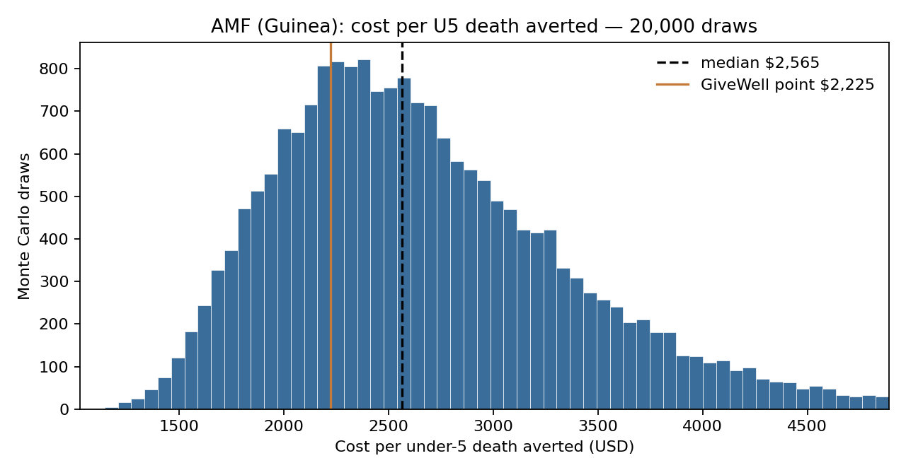

*Figure 1. Each bar is how often the model landed near that dollar figure. The orange line is GiveWell’s single best guess ($2,225); the dashed line is the middle of our simulated outcomes ($2,565). Almost all mass sits under $5,000.*

The median sits ~15% above the point estimate because several input ranges are **right-skewed** (a long tail toward higher costs or lower impact). That is expected when you replace “best guess” with “best guess ± asymmetric uncertainty.” It does *not* mean the mode-chain failed calibration.

**Top five drivers** of uncertainty (Spearman correlation with log cost per death; larger absolute value = more influence):

1. **Baseline malaria mortality** (−0.63) — if malaria is deadlier without nets, each net prevents more deaths → cost per death *falls*  
2. **Usage rate** (−0.45) — unused nets waste money  
3. **Cost per net** (+0.37) — higher costs raise $/death directly  
4. **Years of net efficacy** (−0.32) — longer-lived nets → more protection per dollar  
5. **Protective efficacy** (−0.26) — weaker real-world protection → worse CE  

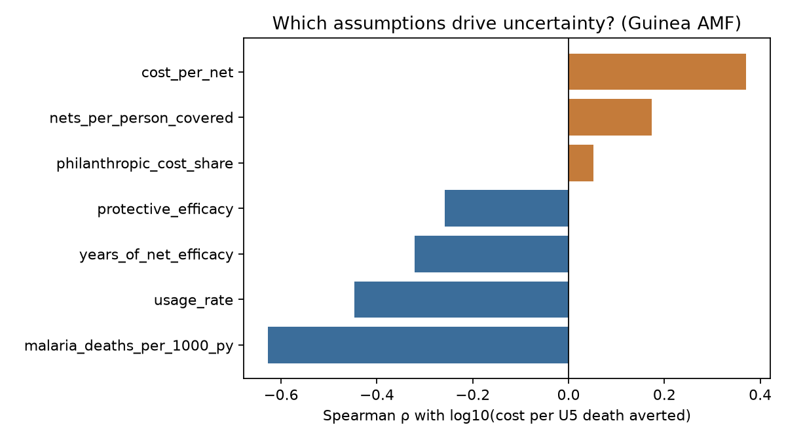

*Figure 2. Rank-correlation tornado for the Guinea AMF Monte Carlo.*

#### How to read the tornado chart (Figure 2)

This is a **rank-correlation tornado**: a sensitivity chart that shows which uncertain assumptions most move together with the outcome across the 20,000 simulated worlds.

**What each bar is.** Each row is one model input (cost per net, usage rate, etc.). The bar length is the **Spearman rank correlation** (ρ) between that input and log₁₀(cost per under-5 death averted). Spearman asks: when this input is *relatively* high in a draw, is cost per death *relatively* high or low? Values near 0 mean that input barely tracks the outcome; values farther from 0 mean it is a bigger driver of the spread in Figure 1.

**Left vs right (color).**
- **Blue bars (left of zero):** higher values of that input tend to go with *lower* cost per death (better cost-effectiveness). Example: higher baseline malaria mortality → more deaths to avert → cheaper per death averted.
- **Orange bars (right of zero):** higher values tend to go with *higher* cost per death (worse CE). Example: higher cost per net → worse $/death.

**How to use it for a decision.** Focus on the longest bars first. Here, **baseline malaria mortality** and **usage** dominate; philanthropic cost share barely matters. A skeptical review should pressure-test those top drivers—not every cell in the spreadsheet equally. If you became convinced that usage is much lower *and* baseline mortality much lower than GiveWell’s range, the cost-per-death distribution in Figure 1 would shift right (worse); if those hold up, the “usually under $5k” conclusion is harder to overturn.

**What this chart is not.** It is not a classic one-way tornado that moves one input to its low/high while freezing all others. Here every input varies together in the Monte Carlo; the bars measure how inputs and the outcome move together, not “dollar change if I change X alone.” Figure 3 supplies that classic one-way view. Figure 2 also does not say which input is *most uncertain* in the real world—only which ones, given the ranges we used, most shape the simulated answer.

#### One-way sensitivity on the top five drivers

Hold every input at its GiveWell best guess (~**$2,224** per U5 death—the calibration point), then move **one** input at a time to the low and high of its uncertainty range. The bar is the resulting span of cost per death; circle = outcome at the input’s low end; square = outcome at the input’s high end.

| Input (moved alone) | At input low | At input high | Swing |
|---|---:|---:|---:|
| Baseline malaria mortality | $3,771 | $1,619 | **$2,152** |
| Cost per net | $1,858 | $3,021 | $1,163 |
| Years of net efficacy | $2,914 | $1,901 | $1,014 |
| Usage rate (5th–95th of beta) | $2,790 | $1,867 | $923 |
| Protective efficacy | $2,693 | $1,930 | $762 |

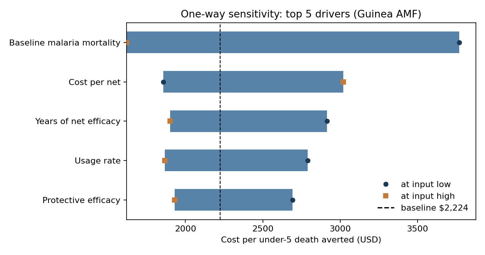

*Figure 3. Classic one-way tornado for the five largest Spearman drivers. Baseline (dashed) ≈ GiveWell’s $2,225 point.*

#### Takeaway from the two sensitivity approaches

**Both say the same decision story.** Baseline malaria mortality is the input that most moves cost per under-5 death averted. Usage and cost matter next. No single lever alone pushes the answer past ~$4,000—overturning “usually under $5k” still needs several adverse assumptions stacked.

**Where they disagree is ranking of #2 vs #3,** and that is informative, not a bug:

| Approach | What it asks | Top drivers here |
|---|---|---|
| **Spearman (Monte Carlo)** | When *everything* varies together, which inputs move with the outcome distribution? | Mortality → **usage** → cost |
| **One-way** | If I change *only* this input to its low/high, how far does the dollar answer move? | Mortality → **cost** → years → usage |

Usage looks bigger in Monte Carlo because it is a high-leverage share in the chain and varies in every draw; cost looks bigger one-way because its published triangular range is wider than the tight beta used for usage (no GiveWell CI on usage; we use that beta’s 5th–95th).

**Practical takeaway for a reviewer.** Pressure-test **mortality and usage** first (epidemiology / real-world net use)—those dominate when all inputs vary together. Check **cost per net** next as a wide swing when moved alone. Don’t treat the two tornado orderings as conflicting conclusions; treat them as “all inputs varying” vs “one input at a time” views of the same model.

### What would change my mind (Guinea AMF)

- Treating **funging** as part of the primary metric, if the real question is “donor CE after other funders pull back,” not U5 $/death before displacement.
- Strong evidence that high baseline mortality and high protective efficacy move *together* (or against each other) in ways that shrink the expensive tail.
- A material GiveWell revision to Guinea mortality or usage that moves the best guess by more than about 2×.

### Limitations (Guinea AMF)

Independent random draws ignore real-world correlations. Insecticide resistance is baked into GiveWell’s efficacy number rather than modeled as its own uncertain layer. The $5k / $10k bars are **illustrative comparison points**—not GiveWell’s official funding rule. The chain is a simplified U5 pre-adjustment object; GiveWell’s all-age “final cost per life saved” after funging and other adjustments is about **$2,941**. Guinea AMF is on the order of **~23×** GiveWell’s benchmark in the public workbook.

---

## Part 2 — Portfolio rank-order: who is #1 under uncertainty?

Part 1 stress-tests one program in one country. This part asks whether the order of GiveWell’s top-charity geographies still holds when each geography’s cost-effectiveness is uncertain.

### Decision

**Helen Keller’s vitamin A program in Niger stays first among 87 GiveWell program-geographies in about 84% of draws.**

The unit is the one GiveWell uses to compare programs: multiples of its benchmark per dollar, where a higher multiple is better. Niger’s published best guess is 58.9 times that benchmark. New Incentives’ cash transfers for vaccination in Sokoto are first in about 12% of draws. The order of the full list barely moves. The top five do swap: the set overlaps the published top five only about 57% of the time. Those swaps are among strong programs.

Against Malaria Foundation bed nets in Guinea are about 23 times the benchmark and almost never rank first. A low cost per death in one country is not the same thing as the highest multiple in the full list.

### Methodology

**Object.** Stability of **rank order** across GiveWell Top Charity program × geography cells when each cell’s cost-effectiveness is uncertain.

**Universe.** 87 initiative-geographies from GiveWell’s public moral-weights / CE table: Against Malaria Foundation, Malaria Consortium (SMC), Helen Keller Intl (vitamin A), and New Incentives.

**Metric.** Cost-effectiveness as a **multiple of GiveWell’s benchmark** (higher is better). Same unit GiveWell uses to compare programs; *not* the $/U5-death object in Part 1.

**Data pipeline.**
1. **Point estimates** from the moral-weights tool (`moral-weights-tool.xlsx`, “× benchmark / × cash using GW weights”).
2. **Uncertainty ranges** from each charity’s CEA **Sensitivity analysis** sheet: published 25th / best / 75th on final CE where available (AMF, HKI, most Malaria Consortium geos). Tagged `sensitivity_joint` in `portfolio_ce_ranges.csv`.
3. Where no joint final-CE CI exists (all New Incentives states; some Malaria Consortium geos), **impute** relative width (`ce_25/ce_best`, `ce_75/ce_best`) from that charity’s peer geos, or the global median if the charity has no native CIs. Tagged `imputed_rel_width`.
4. If the CEA best guess and moral-weights point differ slightly, **rescale** the 25/75 bounds so the triangle is centered on the moral-weights point.

**Simulation.**
1. For each geography, draw CE independently from Triangular(ce_25, ce_best, ce_75), **20,000** times (fixed seed).
2. In each draw, rank all 87 geos by drawn CE (1 = highest).
3. Report: P(rank = 1), median / mean rank, top-5 set Jaccard vs the point-estimate top 5, pairwise win rates among the point top tier, and charity-level P(that charity owns the single best geography that draw).

**Code.** `python projects/01-givewell-cea-uncertainty/run_portfolio_ranks.py` → `portfolio_ce_ranges.csv`, `portfolio_pairwise_top8.csv`, `figures/portfolio_*.png`.

### How to read “rank under uncertainty”

A point ranking says “HKI Niger is #1 at 58.9×.” Under uncertainty each initiative becomes a **range**. Overlap means #2 can beat #1 in some worlds. **P(rank = 1)** is the share of simulated worlds in which that initiative has the highest CE. Stable rankings hug the diagonal in a point-rank vs median-MC-rank scatter; messy rankings fan out.

### Results

| Finding | Number |
|---|---|
| Initiatives in portfolio | 87 |
| Point-estimate leader | Helen Keller International — Niger (58.9×) |
| P(HKI Niger remains #1) | **84%** |
| P(New Incentives Sokoto is #1) | ~12% |
| Spearman ρ (point rank vs median MC rank) | **0.999** |
| Mean Jaccard overlap of top-5 set vs point top-5 | ~0.57 |
| P(HKI owns the best geography, charity-level) | ~86% |
| P(New Incentives owns the best geography) | ~13% |
| P(Malaria Consortium / AMF owns the best geography) | ~0.5% / ~0% |

**Headline for a grantmaker:** uncertainty **does not** overturn the top of the list. HKI Niger stays #1 in most draws. Mid-pack geographies (roughly ranks 5–20) **do** swap places often—the top-5 *set* only partly overlaps the point-estimate top 5 (~57% Jaccard)—but those swaps are among still-very-strong programs, not a collapse of the leader into the pack.

AMF Guinea (~23× point), the focus of Part 1, sits around **rank 10–12** on point estimates and almost never becomes the portfolio #1 under these ranges. That is consistent with “Guinea nets look excellent on a $/death lens” while “other GiveWell-supported geographies look even stronger on the ×-benchmark ledger.”

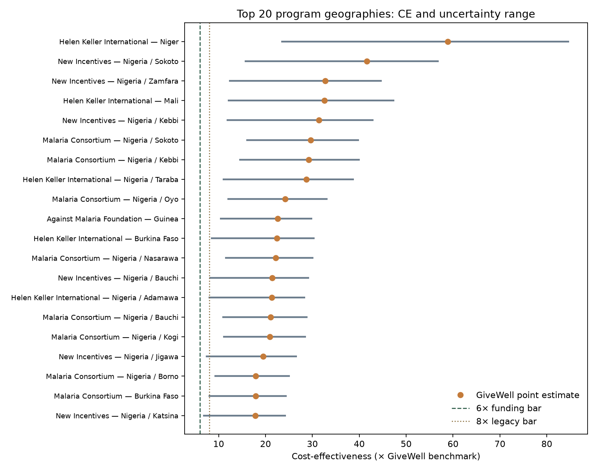

*Figure 4. Orange dots = GiveWell point estimates. Horizontal bars = 25th–75th CE ranges. Vertical lines mark the 6× (current) and 8× (legacy) funding bars.*

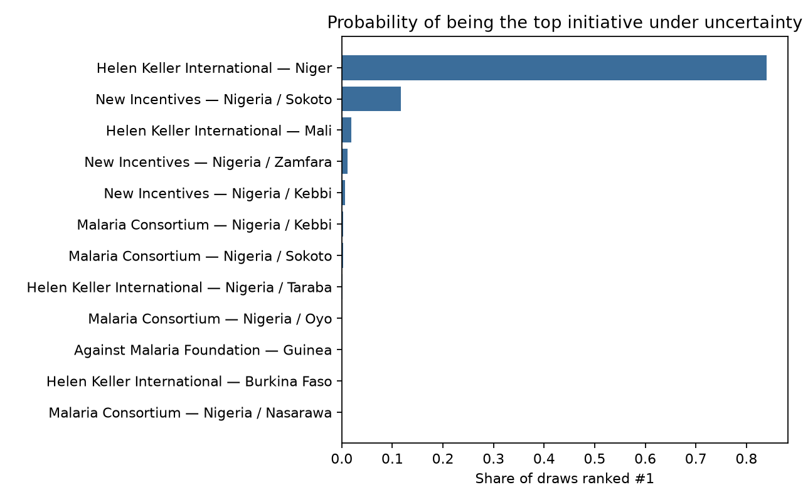

*Figure 5. Only a handful of initiatives have a non-trivial chance of being #1; HKI Niger dominates.*

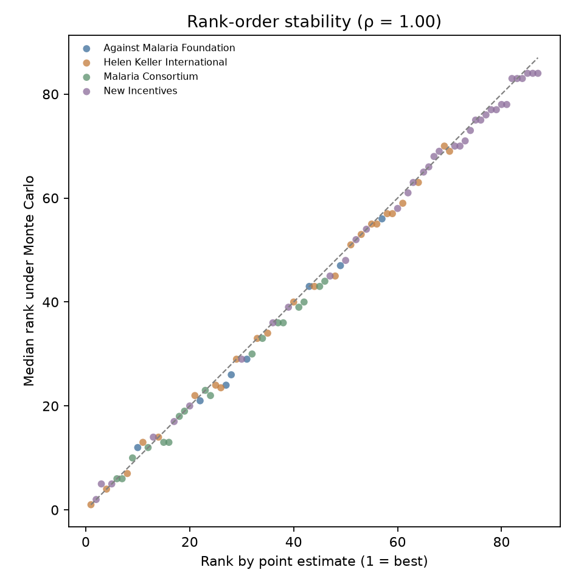

*Figure 6. Points lie near the diagonal: the ordering is highly stable in expectation even though individual mid-rank swaps are common.*

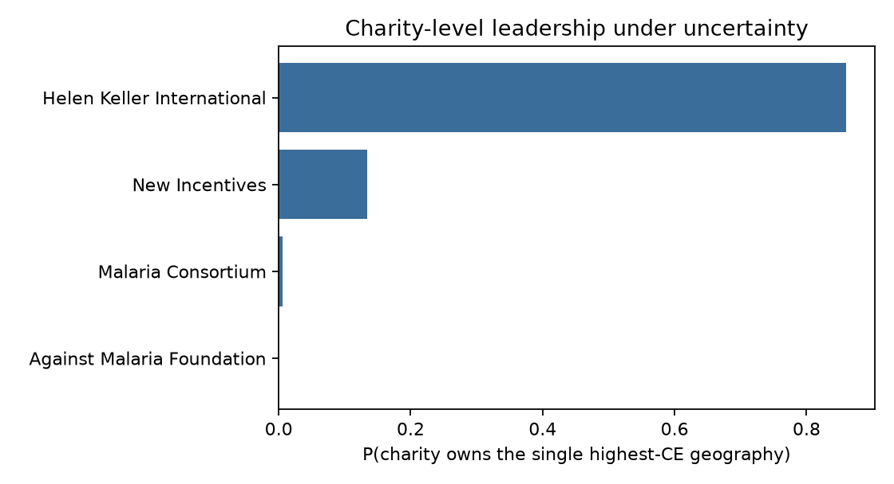

*Figure 7. Collapsing to “best geography per charity,” HKI leads; New Incentives is the main runner-up; AMF and Malaria Consortium rarely hold the single top cell.*

Pairwise among the point top tier: HKI Niger beats New Incentives Sokoto in ~87% of draws; Sokoto vs HKI Mali is closer (~74% for Sokoto). Full table: `portfolio_pairwise_top8.csv`.

### What would change my mind (portfolio rank)

- Published joint CE intervals for New Incentives (and other imputed rows) that are much **wider** than peer charities—enough for Sokoto-like geographies to overtake HKI Niger in a majority of draws.
- Strong **positive correlation** of errors across HKI geographies, or **negative** correlation between HKI and New Incentives, that a grantmaker believes should be modeled; independent draws are a simplification.
- A GiveWell revision that moves HKI Niger’s point estimate down (or NI Sokoto’s up) by enough to change who leads on the moral-weights table itself.

### Limitations (portfolio rank)

This is **not** a full re-implementation of every charity’s causal model; it propagates GiveWell’s published final-CE uncertainty (or imputed widths) through ranks. Independent draws across initiatives understate portfolio-level common shocks (shared moral weights, shared disease-burden data). Imputed CIs for New Incentives are a first-order caveat. “Owns the best geography” is not the same as “receives the most GiveWell funding” or “has the highest room for more funding.”

---

## Part 3 — Top Charities Fund: who clears the CE screen?

GiveWell’s Top Charities Fund grants only to its top charities: the Against Malaria Foundation, Malaria Consortium, Helen Keller International, and New Incentives. Staff also weigh funding gaps, room for more funding, and implementation. The piece that can be stress-tested is the cost-effectiveness screen: a minimum multiple of GiveWell’s benchmark.

### Decision

**About half of 87 program-geographies clear a cutoff of 6 times the cost-effectiveness of cash transfers. About 18 sit close enough that uncertainty can move them across it.**

On the published best guess, 50 of 87 are at or above 6 times that benchmark. In a typical draw, about 48 still clear. Malaria Consortium’s seasonal malaria program clears in essentially all 18 of its geographies. New Incentives clears in 11 of 37 states on the best guess. Against Malaria Foundation bed nets in Guinea clear both the 6-times cutoff and a stricter 8-times cutoff in essentially every draw.

This is how often a geography stays above the published bar. It is not a prediction of which grant GiveWell will make.

### Operational rule (proxy, not GiveWell’s full process)

1. Every initiative-geography in this portfolio is already a Top Charity program.  
2. In each Monte Carlo draw, mark a geo **CE-screen eligible** if its drawn CE ≥ the funding bar.  
3. Report **P(clear bar)**, rank geos by that probability, and—among draws where a geo clears—its **rank among the eligible set**.  
4. Primary bar: **6×** (GiveWell’s published bar as of May 2026). Robustness: **8×** (prior Top Charities–oriented bar).

This answers: *Under GiveWell’s own CE uncertainty, how often would each initiative-geography clear the TCF-style cost-effectiveness screen—and how does that reorder who looks “in” vs “out”?* It does **not** predict which gaps GiveWell will actually fill next quarter.

Same Monte Carlo and CE ranges as Part 2 (`run_portfolio_ranks.py`).

### Results

| Finding (20k draws) | 6× bar | 8× bar |
|---|---|---|
| Geos above bar on **point** estimate | 50 / 87 | 45 / 87 |
| Mean # geos clearing bar per draw | **~48** (5–95%: 46–51) | **~42** (5–95%: 39–45) |
| Geos that almost always clear (P ≥ 99%) | 33 | 23 |
| Geos that rarely clear (P < 10%) | 34 | 38 |
| Contested geos (5% < P(clear) < 95%) | 18 | — |

**How to read the probabilities.**  
- **P(clear 6×) ≈ 1:** that geography stays above the funding bar in essentially every simulated world—robustly on the right side of the CE screen.  
- **P(clear 6×) near 0.5:** contested—point estimate may sit above the bar, but uncertainty often pulls it below (or vice versa).  
- **Median rank among eligible:** conditional on clearing the bar, where that geo sits in the ranked eligible set (1 = best among those above the bar that draw).

**Headline.** About **half** the published Top Charity geographies clear 6× on the point estimate; under uncertainty the eligible *set size* stays tight (~46–51 geos). **Malaria Consortium** most consistently fills the eligible set (all 18 of its geos are ≥6× on point; ~17.5 clear per draw on average). **New Incentives** has many sub-bar states: only 11/37 clear 6× on point. **AMF Guinea** clears 6× (and 8×) with probability ~1—so Part 1 is about *how good*, not *whether it clears the TCF CE screen*.

Geos that sit just above 6× on the point estimate are the fragile ones: e.g. New Incentives Yobe (6.6× point) clears 6× only ~54% of the time and 8× only ~7%. Geos just below can still sneak in: HKI Ekiti (5.9×) clears 6× ~34% of the time. Full ordering by P(clear 6×): `portfolio_fund_eligibility.csv`.

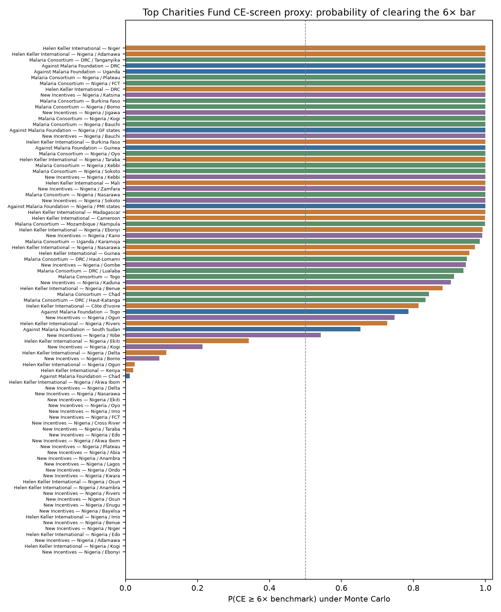

*Figure 8. P(CE ≥ 6×) for all 87 Top Charity program geographies. Color = charity.*

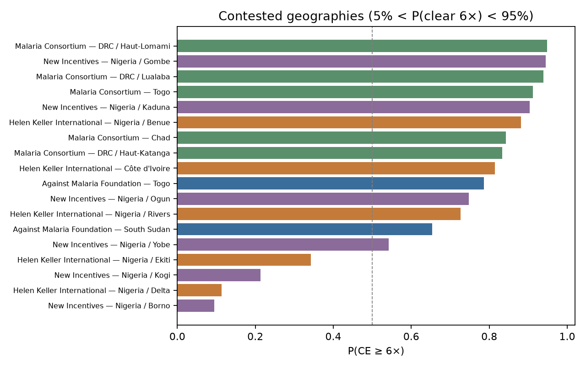

*Figure 9. Contested band (roughly 5–95% clear probability)—where uncertainty can flip “in” vs “out” of a mechanical CE screen.*

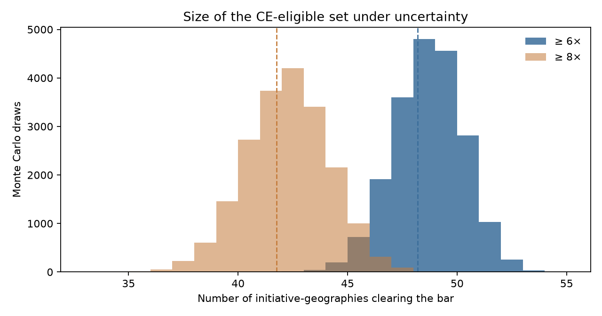

*Figure 10. How many initiative-geographies clear each bar per draw. Eligible-set size is fairly stable; moving from 8× to 6× adds a block of geos.*

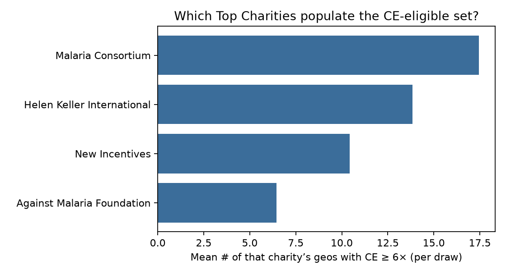

*Figure 11. Which Top Charities populate the CE-eligible set on average. Malaria Consortium contributes the most geos per draw; New Incentives contributes fewer despite having more states in the table.*

### What would change my mind (TCF CE screen)

- A material change in GiveWell’s published bar (e.g. back to 8× or 10×), which would shrink or expand the eligible set sharply.
- Evidence that “room for more funding” or implementation constraints systematically **exclude** high-CE geos that clear the mechanical bar here—or **include** geos that fail it.
- Better joint CE intervals for New Incentives that move many states from “rarely clear” into “usually clear” (or the reverse).

### Limitations (TCF CE screen)

Clearing 6× is a **CE-screen proxy only**. GiveWell’s Top Charities Fund also weighs funding gaps, absorption capacity, urgency, and non-CE factors. This analysis does not model grant size, timing, or fungibility between the Top Charities Fund and other GiveWell vehicles. Same data caveats as Part 2 (imputed widths; independent draws).

---

This note is a transparent uncertainty stress-test across three questions—not a replacement for GiveWell’s process or a standalone funding recommendation.
