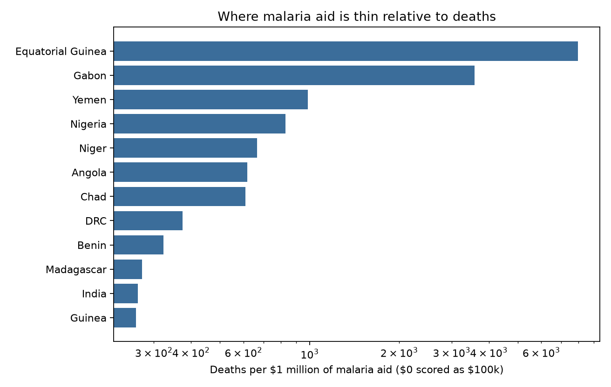
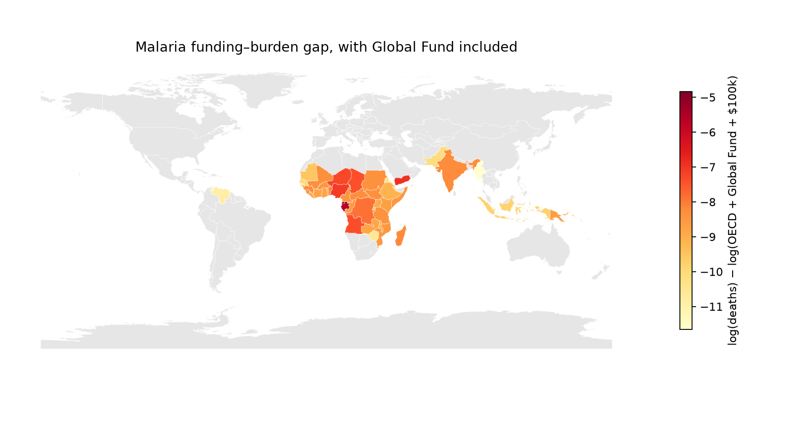
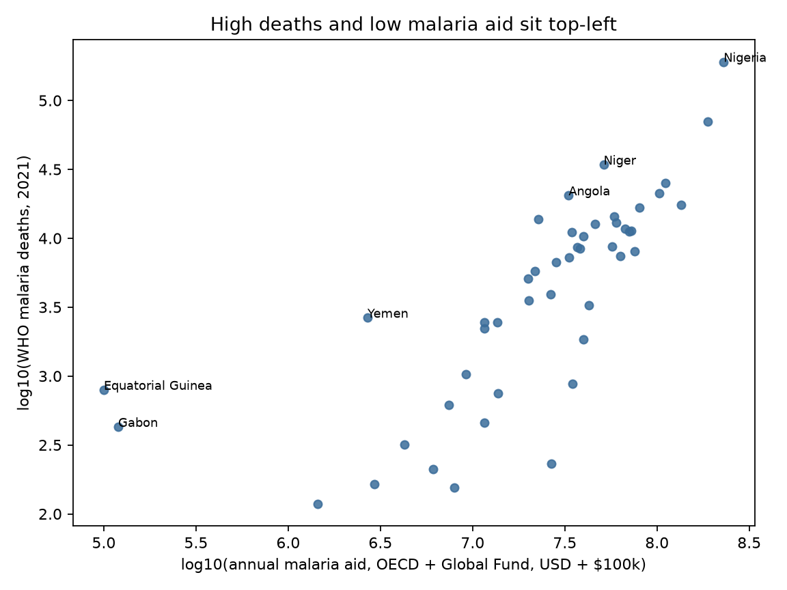
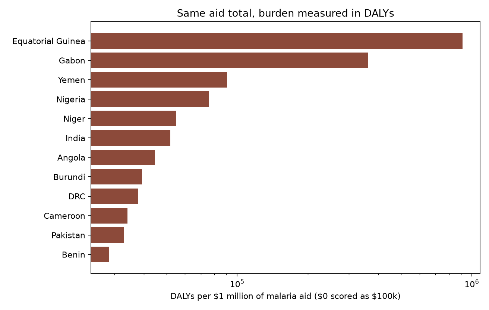
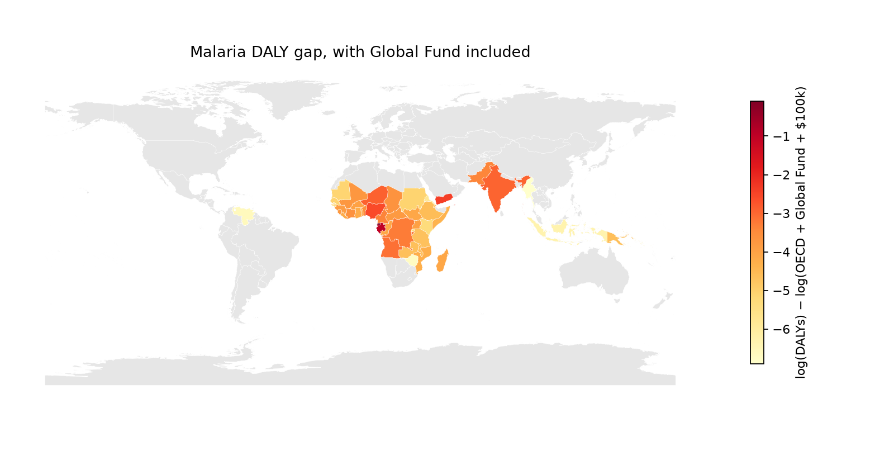
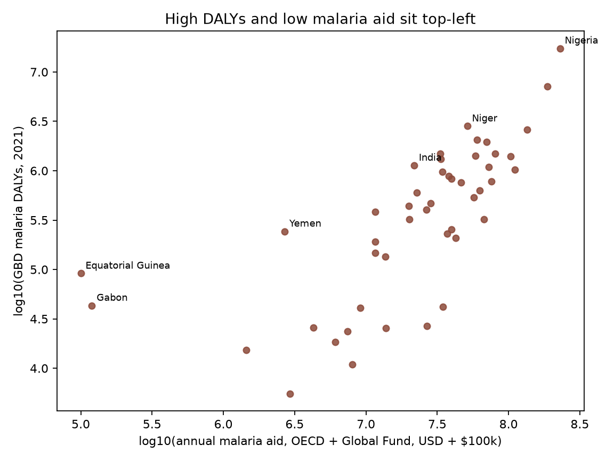

# Malaria: deaths vs aid

### TLDR

The countries with the largest malaria death tolls already receive about as much malaria aid per death as Nigeria, the Democratic Republic of the Congo, and Niger, about $1,500 per death. The gaps that remain are Yemen, about $1.4–1.8 million a year, and Nigeria, about $56 million a year to match Niger’s aid per death.

### Decision

**Most high-burden countries are already at or above about $1,500 in malaria aid per death.** That rate is the middle of what Nigeria, the Democratic Republic of the Congo, and Niger already receive. The same comparison on disability-adjusted life years, a year of healthy life lost, is about $18 per year lost. Aid here is the OECD malaria-control disbursement plus the Global Fund malaria allocation.

| Country | Malaria deaths | Aid per year already | More aid to reach $1,500 per death | More aid to reach $18 per DALY |
|---|---:|---:|---:|---:|
| Nigeria | 191,000 | $230 million | **$56 million** | **$85 million** |
| Yemen | 2,652 | $2.6 million | **$1.4 million** | **$1.8 million** |
| Equatorial Guinea | 795 | $0 | $1.2 million | $1.7 million |
| Gabon | 428 | $20,000 | $0.6 million | $0.8 million |
| DRC | 70,000 | $188 million | $0 | $0 |
| Niger | 34,000 | $51 million | $0 | $0 |
| Chad | 14,000 | $23 million | $0 | $0 |

A **$0** means that country is already at or above both rates. Aid per year is the OECD malaria-control disbursement plus the Global Fund figure for 2020–2022. Equatorial Guinea and Gabon are $0 and $20,000 in that window only.

India, Sudan, Togo, the Central African Republic, the Republic of the Congo, Somalia, and Pakistan are also at **$0**. Each already has a Global Fund malaria allocation of about **$11–37 million** a year. India and Pakistan also report government malaria budgets in the tens of millions.

**Yemen is the grant to price.** It has 2,652 deaths, no Global Fund country allocation, and about $2.6 million a year reported to WHO. Another **$1.4 million** would match the death rate, or **$1.8 million** on DALYs. Yemen shares a regional grant of about **$18 million** for 2020–2022 with five other countries. Split that grant before treating $1.4–1.8 million as new money.

**Nigeria is the only large death toll below the rate.** About 191,000 deaths and about $230 million a year are already counted, roughly **$1,200 per death**. Another **$56 million** a year would match Niger. The DRC is already higher, at about **$2,700 per death**.

Equatorial Guinea (795 deaths) and Gabon (428) top the chart because their 2020–2022 Global Fund cell is empty. The next cycle already sets aside about **$0.7 million** and **$1.1 million** a year, and Equatorial Guinea’s government reports about **$3.6 million** a year. Using DALYs instead of deaths leaves Yemen and Nigeria as the two amounts above. India and Pakistan rank higher on DALYs and stay above $18 per DALY.

### Question

Which countries combine a high malaria death toll with thin malaria aid, once OECD malaria-control disbursements and Global Fund country allocations are counted together?

If a further grant is sized to the aid per death already received by Nigeria, the DRC, and Niger, how much remains for each country?

### Background: how to read this note

| Term | Plain meaning |
|---|---|
| **Burden** | How much harm the disease causes. The main rank uses WHO malaria **deaths** in 2021. The second rank uses IHME **DALYs**. |
| **DALY** | Disability-adjusted life year — one lost year of healthy life, from early death plus time lived with illness. Here: IHME GBD Study 2023 malaria DALYs for 2021, all ages, both sexes. |
| **ODA** | Official development assistance — government aid that meets OECD rules. |
| **CRS** | Creditor Reporting System — OECD’s project-level record of aid flows. |
| **Purpose code 12262** | OECD’s code for **malaria control**. One of the two pieces of the aid total. |
| **Malaria-control line** | That country’s total in the OECD file under code 12262, averaged over 2019–2022. A **$0 line** means no such payment was recorded. It is not the national budget, and it is not a Global Fund grant. |
| **Global Fund allocation** | The three-year envelope the Global Fund set aside for that country’s malaria grants. Published for 2020–2022 and again for 2023–2025. |
| **Annualized allocation** | That three-year envelope **divided by three**, so it can sit next to an annual OECD figure. It is not a reported disbursement. |
| **Government malaria program** | What the country told WHO it contributed to the national malaria program. Shown beside the rank. Not part of the aid total. |
| **Disbursement** | Money actually paid out in a year, not just promised. |
| **DAC donors** | The main government aid donors that report to the OECD Development Assistance Committee. |
| **Constant USD** | Dollars adjusted so 2019 and 2022 can be averaged without inflation mixing the years. |
| **Epsilon ($100k)** | A small floor added to aid before dividing or taking logs, so a true $0 does not make the ratio infinite. |
| **Log gap** | log(deaths) − log(aid + $100k). Aid is the OECD line plus the annualized Global Fund figure. **Higher** means more deaths per dollar. Rank, not the sign, is the result. |

The log gap and deaths-per-million rankings are the **same ordering**. One is the log of the other.

#### What “DAC disbursements coded to malaria control” means

**DAC** is the OECD Development Assistance Committee: the main government aid donors that report aid in one common system. A **disbursement** is cash paid in that year, not a pledge. **Coded** means the donor assigned that payment a purpose code in the Creditor Reporting System. Code **12262** is malaria control.

A $0 on this line means those donors recorded no malaria-control payment to that country in 2019–2022. Money can still reach a malaria program through the Global Fund, through another aid code, or through the country’s own budget.

#### What enters the aid total

**OECD piece.** DAC disbursements, constant dollars, purpose 12262 only, averaged over 2019–2022.

**Global Fund piece.** The malaria row of the Global Fund’s country allocation table for 2020–2022, in the US dollar column the Fund published, divided by three. A country with no row in that table is not given a share of a regional grant.

**Where a figure is estimated.**

1. **Timing, every country with a country allocation.** The three-year envelope is divided by three. Source: Global Fund, *2020–2022 Allocations*, USD equivalent column. Where the Fund set the allocation in euros, the dollar figure is the Fund’s own conversion. This note does not apply a separate exchange rate.
2. **Country amount, Yemen and Gabon.** Neither has a 2020–2022 country malaria allocation. The figure in the rank is the average of the Global Fund amounts the country reported to WHO for 2021–2023. Source: *World malaria report 2024*, Annex 4C, “Global Fund” under contributions reported by countries. Yemen reported about $2.2 million, $2.1 million, and $3.5 million (average **$2.6 million**). Gabon reported $0, $59,000, and $0 (average **$20,000**). A regional Middle East grant of about **$18 million** for 2020–2022, shared with Iraq, Jordan, Lebanon, Palestine, and Syria, is not divided and is not assigned to Yemen.
3. **Equatorial Guinea is left blank.** It has no 2020–2022 country allocation and no Global Fund figure in Annex 4C, so the rank uses **$0**. That is an empty cell. The 2023–2025 allocation is $2 million over three years and sits outside this window, so it is not in the rank.

Government contributions from Annex 4C are the mean of the years the country reported. A missing year stays missing. It is not filled with zero, and it is not added to aid.

#### Why the ranking uses a log gap

The log gap is deaths per dollar of the combined aid total:

\[
\log(\text{deaths}) - \log(\text{aid} + \$100{,}000) = \log\left(\frac{\text{deaths}}{\text{aid} + \$100{,}000}\right)
\]

A country with 10,000 deaths and $10 million of this aid has the same gap as one with 100,000 deaths and $100 million. Nigeria can have the largest death toll and still sit near countries with far fewer deaths when its aid is also large. The $100,000 floor keeps a recorded $0 defined.

### Methodology

**Object.** Country-level gap between 2021 malaria deaths and annual malaria aid. Aid is the 2019–2022 OECD malaria-control average plus the 2020–2022 Global Fund malaria allocation divided by three.

**Rules** (in `cause_crosswalk.yaml`):

1. OECD piece = DAC **disbursements**, constant USD, purpose **12262 only**, averaged over 2019–2022.
2. Global Fund piece = country malaria **allocation**, 2020–2022, divided by three. Yemen and Gabon use the Annex 4C country report. Equatorial Guinea stays $0.
3. Government malaria-program spending is reported beside the rank and is not part of it.
4. Primary burden = WHO estimated malaria **deaths**, 2021.
5. Keep countries with at least **100** deaths.
6. Rank by log(deaths) − log(aid + $100,000). The same formula on OECD disbursements alone is a sensitivity: it shows what the OECD file says when the Global Fund channel is omitted.
7. Second burden = IHME GBD Study 2023 malaria **DALYs** for 2021, same 47 countries and the same combined aid total.
8. Purpose 12250 (infectious disease control) and humanitarian codes are not treated as malaria aid.

**Aid-amount rule.** The benchmark is the median of Nigeria, the DRC, and Niger: about **$1,500 per WHO death** and about **$18 per DALY**. Both medians are Niger’s own ratios. Additional annual aid is that rate times the burden, minus aid already in the combined total. This is a comparison with those three programs. It is not a cost per death averted.

**Sources.** OECD CRS, purpose 12262, 2019–2022. Global Fund allocation tables, 2020–2022 and 2023–2025. WHO, *World malaria report 2024*, Annex 4C. WHO Global Health Observatory, malaria deaths, 2021. IHME GBD Study 2023, malaria DALYs, 2021. The ranked table is `funding_burden_ranked.csv`. Figures are in `figures/`.

### Results

47 countries meet the death threshold. **11** have zero OECD 12262 disbursements. One country, Equatorial Guinea, also has a zero Global Fund figure in this window.

| Rank | Country | Deaths (2021) | OECD 12262 | Global Fund in the rank | How the Global Fund figure was made |
|---|---|---:|---:|---:|---|
| 1 | Equatorial Guinea | 795 | $0 | $0 | Empty cell. No 2020–2022 allocation and no Annex 4C Global Fund figure |
| 2 | Gabon | 428 | $0 | $20,000 | Average of Annex 4C country reports, 2021–2023 |
| 3 | Yemen | 2,652 | $0 | $2.6 million | Average of Annex 4C country reports, 2021–2023 |
| 4 | Nigeria | 190,761 | $90 million | $139 million | 2020–2022 allocation divided by three |
| 5 | Niger | 34,234 | $15 million | $36 million | 2020–2022 allocation divided by three |
| 7 | Chad | 13,801 | $0 | $23 million | 2020–2022 allocation divided by three |
| 8 | DRC | 70,300 | $56 million | $131 million | 2020–2022 allocation divided by three |
| 11 | India | 5,760 | $0 | $22 million | 2020–2022 allocation divided by three |

Leaving the Global Fund out of the total, and ranking on OECD disbursements alone, puts Chad, India, Sudan, Togo, and Yemen first. Spearman correlation between that ordering and the combined-aid rank is about **0.44**. Three of that top 10 (Equatorial Guinea, Yemen, and Chad) remain in the combined-aid top 10. Chad is 7th once its **$23 million** Global Fund allocation is counted. India is 11th once its **$22 million** allocation is counted.

*Figure 1. Longer bar = more deaths per dollar of OECD malaria-control disbursements plus the annualized Global Fund allocation. The axis is a log scale. A $0 total is scored as the $100k floor. Equatorial Guinea’s bar uses that floor.*

*Figure 2. Darker red = higher log gap (more deaths per dollar of combined aid). Gray = under 100 estimated deaths, or no join. Read the color as a rank, not as a dollar recommendation.*

*Figure 3. Each point is a country. Equatorial Guinea and Gabon sit at the left because their Global Fund figure in this window is $0 or $20,000. Nigeria sits up and to the right: the most deaths, and about $230 million a year of combined aid.*

#### Countries with no OECD malaria-control disbursement, or only a token one

| Country | Death rank | DALY rank | OECD 12262 | Global Fund per year | Government malaria program |
|---|---:|---:|---:|---:|---|
| Chad | 7 | 14 | $0 | $23 million | $0.9 million in 2023; 2021–2022 not reported |
| India | 11 | 6 | $0 | $22 million | $70 million, $72 million, then $26 million |
| Sudan | 16 | 36 | ~$125,000 | $37 million | $7.7 million, $6.6 million, then $1.9 million |
| Togo | 26 | 24 | ~$9,000 | $20 million | $2.1 million in 2023; 2021–2022 not reported |
| Yemen | 3 | 3 | $0 | $2.6 million, from the WHO country report | Not reported |
| Central African Republic | 13 | 17 | ~$95,000 | $20 million | About $60,000 a year |
| Republic of the Congo | 24 | 23 | $0 | $11 million | About $1.9 million a year |
| Somalia | 21 | 28 | ~$17,000 | $11 million | About $0.3 million a year |
| Pakistan | 43 | 11 | $0 | $11 million | $58 million, $22 million, then $80 million |

Global Fund amounts in this table, other than Yemen, are the 2020–2022 country allocation divided by three. The 2023–2025 allocations are about the same size and are outside the rank window. Government amounts are Annex 4C, years the country reported.

#### GBD DALYs on the same aid total

The DALY rank uses the same formula with DALYs in place of deaths. A higher value means more malaria DALYs per dollar of combined aid.

| DALY rank | Death rank | Country | DALYs (2021) | Combined annual aid | How to read it |
|---|---:|---|---:|---:|---|
| 1 | 1 | Equatorial Guinea | 91,000 | $0 | Empty Global Fund cell in this window |
| 2 | 2 | Gabon | 43,000 | $20,000 | Annex 4C average, including two reported zeros |
| 3 | 3 | Yemen | 243,000 | $2.6 million | Annex 4C average; no country allocation |
| 4 | 4 | Nigeria | 17.4 million | $230 million | Largest DALY count; about $1,200 of combined aid per WHO death |
| 6 | 11 | India | 1.13 million | $22 million | GBD burden is much larger than the WHO death count |
| 11 | 43 | Pakistan | 382,000 | $11 million | WHO counts 460 deaths in the same year |

*Figure 4. Same construction as Figure 1, with GBD malaria DALYs in place of WHO deaths.*

*Figure 5. Same construction as Figure 2, using DALYs.*

*Figure 6. Same construction as Figure 3. India sits with the main group of countries. Its Global Fund allocation is about $22 million a year.*

India and Pakistan are the burden disagreement. GBD assigns India about 1.13 million malaria DALYs against 5,760 WHO deaths, and Pakistan about 382,000 DALYs against 460 WHO deaths. Those ratios are far above a typical years-of-life-lost per malaria death, so the two sources are counting different burdens in South Asia. The aid figures for both countries are published Global Fund allocations, not estimates.

### Recommendations

Match the median intensity of Nigeria, the DRC, and Niger: about **$1,500 per WHO death** and **$18 per DALY**. Additional aid is that rate times the burden, minus aid already counted. Where the death figure and the DALY figure disagree, the range is the recommendation.

**Yemen: about $1.4–1.8 million a year.** WHO deaths imply about **$1.4 million** on top of the $2.6 million country report. DALYs imply about **$1.8 million**. There is no Global Fund country allocation to set next to that report, and Annex 4C has no government malaria-program figure. The regional grant that includes Yemen is about $18 million for 2020–2022 across six countries, and about $20 million for 2023–2025 across seven. This $1.4–1.8 million is the gap in the country series. A grant of that size belongs after that regional grant is split out by country.

**Chad, Togo, the Republic of the Congo, the Central African Republic, Somalia, India, Pakistan, and Sudan: no additional aid on this benchmark.** Each is at or above the peer rate on both deaths and DALYs. Global Fund allocations run from about $11 million a year (the Republic of the Congo, Somalia, Pakistan) to about $37 million (Sudan). A $0 in the OECD malaria-control column means DAC donors did not code a payment to the country under purpose 12262. Government malaria-program spending is a separate column: about $0.9 million in Chad in the one year it reported, about $60,000 a year in the Central African Republic, and about $0.3 million a year in Somalia. India and Pakistan report government budgets on the order of **$20–80 million** a year.

**Equatorial Guinea and Gabon: small tolls, and the next Global Fund cycle already has an allocation.** They are rank 1 and rank 2 because the 2020–2022 Global Fund cell is empty and the $100,000 floor makes a small death toll look large per dollar. On the figures inside the rank, the peer-rate gaps are about **$1.2 million** a year for Equatorial Guinea and **$0.6 million** for Gabon (about **$1.7 million** and **$0.8 million** on DALYs). The 2023–2025 malaria allocations are $2.0 million and $3.2 million over three years, about **$0.7 million** and **$1.1 million** a year. Set next to those later envelopes, Gabon is covered and Equatorial Guinea’s death gap is about **$0.5 million**. Equatorial Guinea’s government reports about **$3.6 million** a year for the malaria program.

**Nigeria: about $56 million a year on deaths, and about $85 million on DALYs, to reach Niger’s intensity.** Nigeria, the DRC, and Niger are the benchmark, and Nigeria is the one below the median. The DRC is above it, at about **$188 million** a year combined and about **$2,700 per death**. The recommendation is about Nigeria’s dollars per death relative to Niger. It is not a proposal to move the DRC’s allocation. About $90 million of OECD malaria-control disbursements and about $139 million of Global Fund allocation are already in Nigeria’s total. If some of that OECD money is the same Global Fund grant counted twice, Nigeria’s gap is wider than $56 million. These two sources do not identify that overlap.

### What would change my mind

- A Global Fund **disbursement** series for 2019–2022, rather than an allocation divided by three, with a material malaria total for Equatorial Guinea or Gabon inside that window.
- A country split of the Middle East regional grant that differs from the $2.6 million Yemen reported to WHO.
- Evidence that OECD purpose 12262 and the Global Fund allocation are the same grants for Nigeria or the DRC. Overlap would lower the combined total and widen Nigeria’s distance from the peer rate.
- A GBD death series for India and Pakistan that lines up with these DALY counts. That would mean the WHO death ranking is the one that is off in South Asia.

### Limitations

- **The annual Global Fund figure spreads a three-year envelope evenly** wherever a country allocation exists. A grant that pays out in one year can differ from the one-third used here.
- **Yemen and Gabon use a WHO country report** in place of a 2020–2022 allocation. Equatorial Guinea is an empty cell. The 2023–2025 allocations for Equatorial Guinea and Gabon are cited above and are outside the rank.
- **The two aid series can count the same grant twice** where a DAC donor coded a Global Fund grant to purpose 12262 and the allocation includes that grant. A country with a $0 OECD line has no such overlap. Nigeria and the DRC might.
- **Government spending is not in the aid total.** Annex 4C is what countries reported. Missing years were left missing.
- **WHO deaths and GBD DALYs disagree in South Asia.** The DALY rank uses the IHME point estimate. The export also has a lower and upper bound, which this rank does not use.
- **One cause, one window.** Purpose 12250, checked as a sensitivity, is infectious disease control and is not malaria-only. It leaves Chad near $1 million a year, which does not stand in for the Global Fund allocation.
