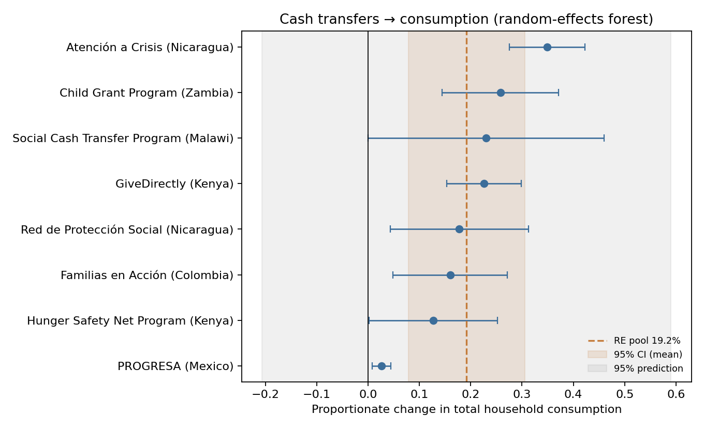
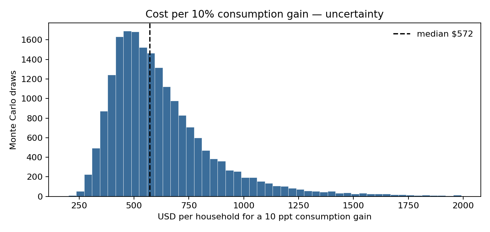

# Evidence note: cash transfers and household consumption

### TLDR

Across eight cash-transfer programs in low- and middle-income countries, household consumption is about 19% higher on average. The programs disagree enough that a new program’s result could include no gain. At a delivery cost like GiveDirectly’s, about $1,100 per household, that average is about $570 per 10 percentage-point increase in consumption.

### Decision

**Cash transfers raise household consumption by about 19% on average. A similar new program might not.**

The average across the eight programs is about +19%. The range for that average is about +8% to +31%, so the average itself is above zero. The range for a new program is about −21% to +59%, which includes no gain. About 94% of the scatter across studies looks like real differences between programs, not sampling noise.

**The dollar figure is about $570 per 10 percentage-point gain in household consumption.** That uses an all-in cost of about $1,100 per household, a transfer plus the cost of delivering it. The middle 90% of the cost draws runs from about $355 to $1,170. This is a cost per consumption gain. It is not a cost per death averted.

### Question

What is the pooled effect of unconditional/conditional cash transfers on **total household consumption**, how heterogeneous is it, and what is a transparent cost per 10% consumption gain?

### Background: how to read this note

#### What a meta-analysis is

A single impact evaluation answers: *Did this program raise consumption in this setting?* A **meta-analysis** combines several such estimates into one summary, weighting more precise studies more heavily, and asks: *Across programs like these, what is the typical effect—and how much do programs disagree?*

Here the outcome is **proportionate change in total household consumption** (e.g. +0.20 means consumption is about 20% higher than the comparison group’s mean). Positive is better for welfare in the short run; this note does **not** convert consumption into DALYs, WELLBYs, or GiveWell “× benchmark” units.

#### Key pieces of this cash / evidence story

| Term | Plain meaning |
|---|---|
| **UCT** | Unconditional cash transfer — money with no behavioral requirements (e.g. GiveDirectly, many African social cash transfers). |
| **CCT** | Conditional cash transfer — money tied to behaviors such as school attendance or health visits (e.g. PROGRESA / Oportunidades in Mexico, Familias en Acción in Colombia — “Families in Action”). |
| **LMIC** | Low- and middle-income country — the population frame for this extract. |
| **Total household consumption** | All spending (food + non-food), often per person or per adult equivalent; a standard poverty/welfare proxy when income is hard to measure. |
| **Proportionate effect** | Impact ÷ comparison (or baseline) mean. +0.23 ≈ “+23% consumption.” |
| **Effect size** | The estimated program impact on that scale (here, proportionate change—not a standardized mean difference). |
| **SE (standard error)** | How noisy the study’s effect estimate is; smaller SE → more weight in the pool. |
| **Forest plot** | Chart of each study’s effect and confidence interval, plus the pooled summary. |
| **Fixed-effect pool** | Assumes one true effect shared by all studies; differences are only sampling noise. |
| **Random-effects (RE) pool** | Allows each program its own true effect; the summary is the **mean of those true effects**. Default when programs differ in design and setting. |
| **DerSimonian–Laird (DL)** | A standard method to estimate between-study variance (τ²) and then form the RE pool. |
| **I²** | Share of observed effect variation that looks like **real program differences**, not chance. High I² → programs disagree a lot. |
| **τ (tau)** | Estimated SD of true program effects on the same scale as the outcome (here, proportionate change). |
| **95% CI (mean)** | Uncertainty in the **average** effect across the included programs. |
| **Prediction interval** | Plausible range for the effect of a **new** similar program—usually much wider than the mean CI when heterogeneity is high. |
| **3ie** | International Initiative for Impact Evaluation — evidence portal / review repository used as the search frame. |
| **GiveDirectly-like cost** | Rough all-in dollars to deliver ~$1,000 to a household (transfer + delivery overhead), used only for the cost conversion. |
| **Cost per 10 ppt gain** | Dollars per household that would “buy” a 10 percentage-point consumption increase if effects scaled that way—an order-of-magnitude CE framing, not a full CEA. |
| **Monte Carlo** | Repeat a calculation many times with random draws from uncertain inputs; summarize the distribution of results. |

#### Fixed effects vs random effects (and why we use random effects)

**Fixed-effect** pooling assumes every program is estimating the *same* true consumption effect; scatter around the mean is just noise from finite samples. That is rarely credible for cash transfers run in different countries, with different transfer sizes, targeting rules, and shock environments.

**Random-effects** pooling assumes each program has its own true effect, drawn from a distribution of effects. The headline number is the **mean** of that distribution. Between-program disagreement shows up as τ² / I² and, importantly, in the **prediction interval**.

#### Confidence interval vs prediction interval

| Interval | Question it answers | If it excludes zero… |
|---|---|---|
| **95% CI for the mean** | Is the *average* effect across these eight programs positive? | The typical (mean) effect is likely positive. |
| **95% prediction interval** | What effect should I expect for a *new* similar program? | A new program would also likely show a positive effect. |

In this extract the **mean CI excludes zero** but the **prediction interval includes zero**. That is the central interpretive point: evidence for a positive *average*, not a guarantee for the next program.

#### What I² is (and is not)

**I² ≈ 94%** means almost all of the scatter across study estimates looks like real differences between programs, not sampling error alone. It is **not** a measure of bias, publication bias, or “quality.” A high I² with a prediction interval that crosses zero is a signal to **lead with heterogeneity**, not to hide behind the mean.

#### Why do this at all?

Grantmakers often hear “cash works.” A meta-analysis forces the next question: *works how much, how consistently, and at what rough cost per consumption gain?* Linking the pool to a transparent cost metric makes the result usable next to health CEAs (like project 01)—with the caveat that consumption % ≠ lives saved.

### Methodology

**Object.** Proportionate change in total (or nondurable total) household consumption under LMIC cash transfers (UCT or CCT).

**Pre-registered rules.** Locked in [`protocol.md`](protocol.md) *before* looking at the forest / pool: one outcome family; one estimate per program; RCT preferred; food-only and cash-plus graduation out of the primary pool; treat the pool as decision-grade only if the mean CI excludes zero **and** interpret the prediction interval honestly when I² is high.

**Data / extraction.** 3ie-linked systematic-review tables (Kabeer & Waddington 2015 on CCT economic outcomes) plus primary evaluation reports for major UCTs (GiveDirectly, Zambia CGP (Child Grant Program), Kenya HSNP (Hunger Safety Net Program), Malawi SCTP (Social Cash Transfer Program)) and Nicaragua’s Atención a Crisis (“Attention to Crisis”). Rows, SEs, and source notes in `extraction.csv` (k = 8 included; one post-exit Atención estimate held out as robustness).

**Model.**
1. Harmonize each estimate to **proportionate change** (level÷mean, or \(\exp(\beta)-1\) from log models with delta-method SE).
2. Inverse-variance **DerSimonian–Laird** random-effects pool.
3. Report mean 95% CI, I², τ, and approximate **prediction interval**.
4. **Cost conversion:** Monte Carlo (20,000 draws) — lognormal all-in cost per household (mean $1,100, CV 15%) and normal draw of the RE mean effect → USD per household for a **10 ppt** consumption gain.

**Code.** `marimo edit projects/03-intervention-meta-analysis/notebook.py` (figures: `forest.png`, `cost_per_10ppt.png`).

**Intentionally left out of the primary pool:** food-only expenditure; poverty headcount without a consumption estimate; enterprise grants / big-push graduation as the main arm; post-exit waves (except as `include=0` robustness); full dual-screened de novo 3ie search.

#### How each study measured the effect

All eight rows were converted to a **proportionate change** before pooling. The studies did not all start in that unit. A randomized comparison group stands in for what treated households would have consumed without the cash. Several studies still use **difference-in-differences**: follow-up minus baseline for the treated group, minus the same change for the comparison group. That second subtraction removes shocks that hit everyone (a drought, a price spike, a good harvest).

| Program | Design | What was compared | Effect used here |
|---|---|---|---|
| **PROGRESA** (Mexico; later renamed Oportunidades) | Randomized communities | Proportionate gap between beneficiary and comparison households, as already calculated by Kabeer & Waddington (2015) from Handa et al. | **+2.6%** (95% CI 0.8–4.4%) |
| **Familias en Acción** (Colombia; “Families in Action”) | Not randomized. Difference-in-differences against comparison areas chosen to look similar | Change in beneficiary communities minus change in comparison communities. The assumption is that the two sets of places would have moved together without the program | **+16%** (95% CI 4.8–27%), from the same review |
| **Red de Protección Social** (Nicaragua; “Social Protection Network”) | Randomized trial, with difference-in-differences | Change in treated communities minus change in control communities | **+18%** (95% CI 4.3–31%), from the same review |
| **GiveDirectly** (Kenya) | Households randomized within villages | About nine months after transfers started, monthly nondurable spending of treated households versus other households in the same villages: **+$36** (US dollars; SE $5.85) against a comparison mean of **$158** | **+$36 / $158 = +23%** |
| **Zambia Child Grant** | Communities randomized; difference-in-differences at 36 months | Change in per-person monthly consumption in treated communities minus the change in control communities: **+10.44 kwacha** (Zambian currency; t = 4.45) versus a baseline mean of **40.48 kwacha** | **+26%**. Standard error = (effect / t) / baseline mean |
| **Atención a Crisis** (Nicaragua; “Attention to Crisis”) | Communities randomized. Follow-up regression, not a pure difference-in-differences | 2006 log per-person consumption, while transfers were still being paid, controlling for baseline log consumption: **+0.299 log points** (SE 0.028) | **exp(0.299) − 1 = +35%** |
| **Hunger Safety Net** (Kenya) | Communities randomized; difference-in-differences over about two years | Change in monthly consumption per adult equivalent for recipients minus the change for controls: **+247 shillings** (Kenyan currency), versus a treated baseline mean of **1,941**. Much of this gap was control households falling during a drought while recipients fell less | **+13%**. No published standard error; this note uses effect / 1.96 |
| **Malawi Social Cash Transfer** | Communities randomized to immediate entry or a delayed-entry control; baseline, midline, and endline | Endline impact stated as **+23%** of baseline per-person consumption (about 10,380 kwacha, Malawian currency) after about two years of transfers | **+23%** kept as published. No published standard error; same conservative bound as Hunger Safety Net |

### Results

| Quantity | Value | How to read it |
|---|---|---|
| Programs in primary pool (k) | 8 | One preferred estimate each |
| RE mean effect | **+19.2%** | Typical average across these programs (\(\hat\mu_{\mathrm{RE}}\)) |
| 95% CI (mean) | +7.9% to +30.5% | Uncertainty in the *average*: \(\hat\mu_{\mathrm{RE}} \pm 1.96\cdot\mathrm{SE}(\hat\mu_{\mathrm{RE}})\). Mean is clearly above zero. |
| I² | **94%** | Almost all scatter looks like real program differences |
| τ (SD of true effects) | 0.15 | True effects vary a lot on the % scale; enters the prediction interval as \(\tau^2\) |
| 95% prediction interval | **−20.6% to +59.0%** | Range for a *new* program: \(\hat\mu_{\mathrm{RE}} \pm t_{0.975,\,k-2}\cdot\sqrt{\mathrm{SE}(\hat\mu_{\mathrm{RE}})^2+\tau^2}\). Wider than the CI because it adds \(\tau^2\); here it crosses zero. |
| Cost / 10 ppt consumption gain (median) | **~$572** / household | Order-of-magnitude CE framing |
| Cost 5–95% | ~$355 – $1,172 | Monte Carlo band on cost and pooled effect |

**CI vs prediction interval (same center, different width).** Both use \(\hat\mu_{\mathrm{RE}}\). The CI only uses uncertainty in the mean (\(\mathrm{SE}\)). The prediction interval also adds between-program variance \(\tau^2\) and a \(t\) critical value (here \(k=8\) → df = 6) instead of 1.96—so it blows out when \(I^2\) / \(\tau\) is large.

*Figure 1. Each row is one program’s proportionate consumption effect with a 95% confidence interval. The orange dashed line is the random-effects mean; the light orange band is the mean’s 95% CI; the gray band is the prediction interval for a new similar program.*

#### How to read the forest plot (Figure 1)

**What each row is.** A program-level estimate of how much total household consumption moved (proportionately) because of the cash transfer. The horizontal whisker is that study’s 95% CI (roughly: effect ± 1.96 × SE).

**Where the pool sits.** The orange line (~+19%) is the RE mean. Studies with tighter confidence intervals (smaller standard errors) get more weight in that average; PROGRESA’s small, precise effect sits far left but still counts as one program among eight.

**Gray vs orange bands.** The narrow orange band is the mean CI (\(\pm 1.96\cdot\mathrm{SE}\)). The wide gray band is the prediction interval (\(\pm t\cdot\sqrt{\mathrm{SE}^2+\tau^2}\)). When gray covers zero but orange does not, say: “on average these programs raised consumption; a new one might not.”

**What the chart is not.** It is not a list of GiveWell funding recommendations. It does not adjust for transfer size, duration, or local prices beyond what each study already did. It is not proof against publication bias.

Point estimates in this extract range from roughly **+3% (PROGRESA)** to **+35% (Atención a Crisis, during program)**. African UCTs here (GiveDirectly, Zambia CGP (Child Grant Program), Malawi SCTP (Social Cash Transfer Program)) cluster nearer **+20–26%**; Kenya’s HSNP (Hunger Safety Net Program) is smaller (~+13%). That **spread** is the decision-relevant result.

#### How to read the heterogeneity

| Question | Answer in this extract |
|---|---|
| Averaging across these programs, is the typical effect positive? | **Yes** (mean CI excludes zero). |
| If I fund a *new* similar program, what consumption effect should I expect? | **Wide range**—zero is inside the prediction interval. |

**Why might programs disagree?** The forest plot’s spread (+3% to +35%) is large enough that “cash raises consumption” is not one number. Plausible drivers—not proven here—include:

- **Transfer size** — a transfer that is a large share of what households already consume will usually move consumption more than a small one.
- **Conditionality** — UCT vs CCT (rules attached to the cash) can change who gets money and how it is spent.
- **Drought / shock context** — in a bad year, cash may mainly stop consumption from *falling* (a safety net), so the measured gain vs control looks different than in a calm year.
- **Timing** — effects measured *while* transfers are still flowing are often larger than effects measured *after* the program stops.

**What we did not do.** A **meta-regression** would statistically test those ideas (e.g. regress study effects on transfer/consumption share). This note only pools the average and reports how wide the scatter is—so those drivers are **hypotheses**, not estimated results.

*Figure 2. Distribution of USD per household implied for a 10 percentage-point consumption gain, combining uncertainty in the pooled effect and in all-in delivery cost.*

#### How to read the cost figure (Figure 2)

Figure 2 answers: **If cash typically raises consumption by X%, how many dollars per household does it take to get a fixed 10 percentage-point increase?** Using the same 10% target for every comparison puts programs with different effect sizes on one cost-per-outcome scale.

**What the calculation is.** You combine two uncertain inputs:

1. **All-in cost** ≈ $1,100 per household (transfer + delivery overhead).
2. **Typical effect** ≈ +19% consumption (the random-effects mean).

\[
\text{cost per 10 ppt gain} \approx \frac{\text{all-in \$ per household}}{\text{pooled proportionate effect} / 0.10}
= \text{all-in \$} \times \frac{0.10}{\text{effect}}
\]

**Worked example.** If a program delivers **+19%** for **$1,100**, each percentage point of gain costs about \(1100 / 19 \approx \$58\). Ten percentage points → about **$580**. Same idea in words: if the typical effect were +20%, a 10 percentage-point gain is half of that typical effect, so the cost for 10 points is about half of $1,100. **A larger pooled effect means a lower cost per 10 points; a smaller effect means a higher cost.** This is only an order-of-magnitude estimate.

**What the histogram shows.** We do not know cost or effect exactly, so we repeat the calculation **20,000** times: each time draw a new effect from a normal distribution centered on the random-effects mean (spread equal to its standard error); draw a new cost from a lognormal distribution around $1,100; then recompute cost per 10 percentage points. **Median ~$570** is the middle of those results. The **5–95% range (~$355–$1,170)** is where most of the simulated results fall—not a formal survey confidence interval, just how much this rough estimate moves when both inputs are uncertain.

**What it is not.** Not a GiveWell cost-effectiveness figure in “× cash” or “× benchmark” units. Not an estimate of cost per life saved. Not a claim that spending twice as much buys twice the consumption gain in every setting—we only assume that scaling to make one comparable dollars-per-outcome number.

**Bottom line.** Under these assumptions, a fixed 10% consumption increase looks like roughly **$400–$1,200 per household**, with a typical answer near **$570**. That is useful as a rough comparison next to health cost-effectiveness work (project 01), not as a precise funding threshold.

### What would change my mind

- A larger extract (≥20 programs) with **published SEs for every row** (no `approx_p05_bound`) that shrinks the prediction interval **above** zero.
- Clear evidence that effects scale linearly with transfer / consumption share—then cost per 10 ppt could be re-anchored on transfer intensity rather than a single GiveDirectly-like cost.
- Focusing the decision on **food security or poverty headcount** instead of total consumption (different outcome family → new protocol).
- Strong publication-bias diagnostics that cut the mean effect enough to make even the mean CI include zero.

### Limitations

- **How studies were found.** The numbers are real and cited, but the *search process* was pragmatic—not a new systematic review of everything in 3ie. We started from an existing 3ie-linked published review (Kabeer & Waddington) and then typed effects from a handful of major evaluation reports into `extraction.csv`. We did **not** run a full from-scratch 3ie database search, and we did **not** have two people independently screen studies (dual screening). A broader or dual-screened search could add, drop, or reweight programs.
- **Some standard errors are approximate.** For HSNP (Kenya’s Hunger Safety Net Program) and Malawi we lacked a published SE and used a conservative bound implied by reported significance stars. Those two rows are less precise than the others.
- **Effect metric conversions.** The Atención a Crisis estimate was converted from a log model (\(\exp(\beta)-1\)); that is standard but not identical to every other row’s reporting format.
- **Mostly during-program effects.** Primary estimates are from periods when transfers were still flowing. Effects after programs end can be smaller (the held-out 2008 Atención follow-up is an example).
- **No adjustment for shared methods or publication bias.** Treating each program as an independent draw ignores common evaluation methods and the chance that null results are under-published.
- **Cost figure is a rough comparison tool.** The ~$570 per 10 percentage-point consumption gain is an order-of-magnitude framing under GiveDirectly-like cost assumptions—not a GiveWell-style moral-weighted cost-effectiveness analysis, and not cost per life saved.
